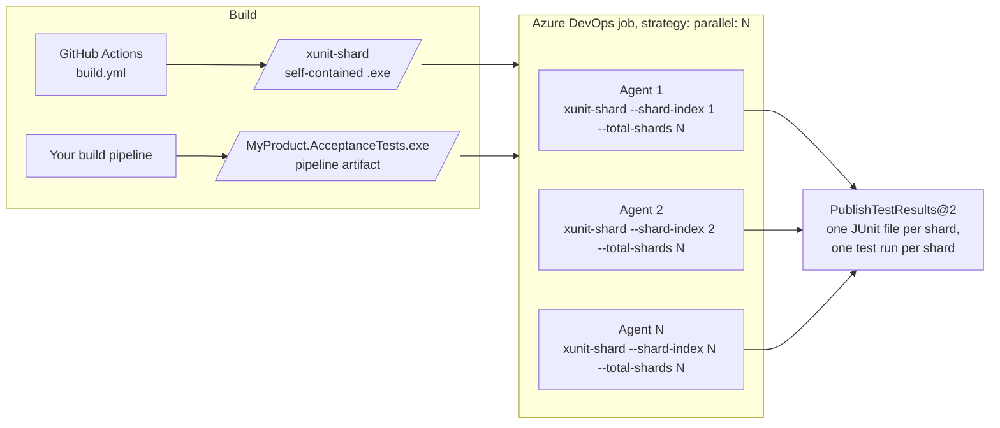
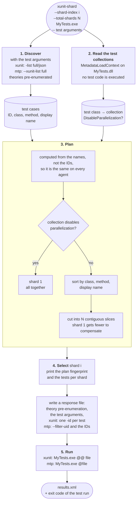

# xunit-test-sharding

[](https://github.com/lucavoit/xunit-test-sharding/actions/workflows/build.yml)

`xunit-shard` splits the tests of an **xUnit.net v3** test assembly into shards and runs one of them. It's typically
used with a **Reqnroll** acceptance test project, so the suite can be spread over several Azure DevOps agents
(`strategy: parallel: N`), each running a part of it.

It is inspired by [Meziantou.ShardedTest](https://github.com/meziantou/meziantou.shardedtest), but is built for
xUnit.net v3 and Reqnroll:

| | Meziantou.ShardedTest | xunit-shard |
| --- | --- | --- |
| Runs the tests with | `dotnet test` | the compiled test executable, with xUnit.net arguments (`-junit`, `-trait-`, ...) or Microsoft.Testing.Platform arguments (`--report-junit`, `--filter-not-trait`, ...) |
| Selects tests by | display name (`--filter DisplayName=...`) | unique test case ID (`-id` or `--filter-uid`) |
| Smallest unit | test case | test case: every theory data row and every example of a scenario outline |
| Collections that disable parallelization | can be split | always kept on one shard |
| Reqnroll non-parallelizable features | can be split | always kept on one shard |
| Distribution | round-robin over sorted names | contiguous slices, so the scenarios of a feature mostly stay together |
| Command line length | split into several `dotnet test` runs | no limit (response file): one run and one report per shard |

## Contents

- [How it works](#how-it-works)
- [Sharding rules](#sharding-rules)
- [Usage](#usage)
- [xUnit.net and Microsoft.Testing.Platform command lines](#xunitnet-and-microsofttestingplatform-command-lines)
- [Getting the tool](#getting-the-tool)
- [Azure DevOps](#azure-devops)
- [Requirements and limitations](#requirements-and-limitations)
- [Development](#development)

## How it works

The test project is built once. Then N agents each download the same test executable, run `xunit-shard` with their own
shard index, and publish their results:



The agents don't talk to each other. Each one discovers all the tests and computes the **same** plan, then runs only
its own part:



1. **Discover.** `xunit-shard` lists the tests of the test executable with theory pre-enumeration:
   `-list full/json -preEnumerateTheories` with the xUnit.net command line, `--xunit-list full
   --pre-enumerate-theories on` with Microsoft.Testing.Platform (see
   [command lines](#xunitnet-and-microsofttestingplatform-command-lines)). Without pre-enumeration, a theory (and so
   a Reqnroll scenario outline, which is generated as a theory) would be a single test case. The arguments after `--`
   are passed too, so filters apply.
2. **Read the test collections.** `-list` does not report the test collection of a test. `xunit-shard` reads them from
   the metadata of the test assembly with `MetadataLoadContext`, following the xUnit.net rules (see
   [Collections](#collections-that-disable-parallelization)).
3. **Plan.** It splits the tests into N shards (see [Sharding rules](#sharding-rules)). Every agent computes the plan
   from the same test executable, so every agent gets the same plan without any coordination.
4. **Select.** It prints a summary, including a fingerprint of the plan, and keeps the tests of shard *i*.
5. **Run.** It runs the test executable once, with theory pre-enumeration (needed for the IDs to match the
   discovery), the arguments after `--`, and the IDs of the selected tests: `-id <id>` for each test with the xUnit.net
   command line, `--filter-uid <id> <id> ...` with Microsoft.Testing.Platform. The arguments go through a response
   file (`@@ <file>` for xUnit.net, `@<file>` for Microsoft.Testing.Platform), so the number of tests is not limited
   by the length of the command line. Each shard produces exactly one report, and `xunit-shard` returns the exit code
   of the test run.

## Sharding rules

### Every test case is a unit

Each test case reported by xUnit.net can go to any shard: a fact, each data row of a theory, each scenario of a feature,
and each example row of a scenario outline.

### Collections that disable parallelization

In xUnit.net, the tests of a collection defined with `DisableParallelization = true` never run at the same time as
other tests. `xunit-shard` puts **all** these tests on **shard 1**, where xUnit.net runs them one at a time, as it
would without sharding. It finds them by applying the xUnit.net rules:

- `[Collection("name")]`, `[Collection(typeof(T))]` or `[Collection<T>]` on the test class or on one of its base
  classes;
- the matching `[CollectionDefinition("name", DisableParallelization = true)]`, or
  `[CollectionDefinition(DisableParallelization = true)]` on `T` for a type-based collection. Names are
  case-insensitive.

Reqnroll uses the same mechanism. Features tagged with a tag listed in `addNonParallelizableMarkerForTags` get
`[Collection("ReqnrollNonParallelizableFeatures")]`, and Reqnroll defines that collection with
`DisableParallelization = true`:

```json
{
  "generator": {
    "addNonParallelizableMarkerForTags": [ "nonparallel" ]
  }
}
```

```gherkin
@nonparallel
Feature: Database
```

Named collections that don't disable parallelization (`[Collection("Shared fixture")]`) are not special: their tests
can be split.

### Contiguous slices

The other tests are sorted by class, method and display name, then cut into contiguous slices of (almost) equal size.
So the scenarios of a feature mostly stay on the same shard, and its class fixture and `[BeforeFeature]` hooks run on
as few shards as possible. Shard 1 gets fewer of these tests to make up for the serial tests, so that the largest
shard is as small as possible.

### The plan does not depend on the IDs

xUnit.net computes test case IDs from the **path** of the test assembly. Each Azure DevOps agent downloads the tests to
its own directory, so the same test has a different ID on each agent. The plan is therefore computed from the class,
method and display name only. The IDs are used only on the agent that discovered them, to run the selected tests. Tests
that can only be told apart by their ID (same class, method and display name) are kept in the same slice.

The summary prints a **plan fingerprint**: a hash of the sorted test names and the shard count. It must be the same
on every shard of a run. If it isn't, the agents discovered different tests (see
[Requirements](#requirements-and-limitations)).

### Example

The [sample](samples/Reqnroll.Sample) contains 24 test cases: 3 Reqnroll features, one of them tagged `@nonparallel`,
with 2 scenario outlines, plus xUnit facts, theories and collections. With 3 shards:

| Shard | Tests |
| --- | --- |
| 1 | `Database` feature (`@nonparallel`, 2 scenarios), `ExclusiveTests` (type-based collection that disables parallelization, 1), `SerialTests` (named collection that disables parallelization, 2 rows), first 3 examples of *Add many numbers* |
| 2 | last 3 examples of *Add many numbers*, *Add two numbers*, *Subtract two numbers*, first 3 examples of *Stock is reduced when an item is sold* |
| 3 | last example of *Stock is reduced when an item is sold*, `ParallelTests` (1 fact, 4 theory rows), `SharedFixtureTests` (named collection running in parallel, 2) |

```
xunit-shard: Reqnroll.Sample: 24 tests in 3 shards (plan 50e42e728534, xUnit.net runner)
xunit-shard: 5 tests of collections that disable parallelization are kept on shard 1: ExclusiveCollection (1), ReqnrollNonParallelizableFeatures (2), Serial (2)
xunit-shard: tests per shard: 1=8, 2=8, 3=8
xunit-shard: running shard 2/3: 8 tests
```

## Usage

```
xunit-shard [options] <test-assembly> [-- <test arguments>]
```

| Option | Description |
| --- | --- |
| `<test-assembly>` | The test executable (`MyTests.exe`, or the app host without extension on Linux/macOS), or its `.dll` (run with `dotnet`). |
| `--shard-index <n>` | 1-based index of the shard to run. Defaults to the `SYSTEM_JOBPOSITIONINPHASE` environment variable (set by Azure DevOps). |
| `--total-shards <n>` | Total number of shards. Defaults to `SYSTEM_TOTALJOBSINPHASE` (set by Azure DevOps). |
| `--runner <auto\|xunit\|mtp>` | Command line that the test arguments use: `xunit` (xUnit.net), `mtp` (Microsoft.Testing.Platform), or `auto` (default): `mtp` when a test argument starts with `--`, `xunit` otherwise. See [command lines](#xunitnet-and-microsofttestingplatform-command-lines). |
| `--dry-run` | Print the plan and the tests of the shard (ID and display name) without running them. |
| `--verbose` | Print the command lines and the arguments passed to the test executable. |
| `--version` | Print the version of `xunit-shard`. |
| `-h`, `--help` | Show the help. |
| `-- <test arguments>` | Everything after `--` is passed to the test executable, **both** when listing and when running the tests. |

Examples:

```shell
# Shard 2 of 4, JUnit report (xUnit.net v3 up to 3.x)
xunit-shard --shard-index 2 --total-shards 4 MyTests.exe -- -junit results.xml

# xUnit.net v3 4.x renamed the report switches
xunit-shard --shard-index 2 --total-shards 4 MyTests.exe -- -result-junit results.xml

# Exclude the scenarios tagged @manual (Reqnroll tags are xUnit traits named "Category") on every shard
xunit-shard --shard-index 1 --total-shards 4 MyTests.exe -- -junit results.xml -trait- "Category=manual"

# Microsoft.Testing.Platform arguments (the test project uses UseMicrosoftTestingPlatformRunner)
xunit-shard --shard-index 1 --total-shards 4 MyTests.exe -- --report-xunit-junit --report-xunit-junit-filename results.xml --results-directory out --filter-not-trait "Category=manual"

# Look at the plan without running anything
xunit-shard --shard-index 1 --total-shards 4 --dry-run MyTests.exe
```

Exit codes:

| Code | Meaning |
| --- | --- |
| exit code of the test run | the shard was run: 0 when all its tests passed; with Microsoft.Testing.Platform, [its exit codes](https://aka.ms/testingplatform/exitcodes) (2 when tests failed, 8 when no test ran) |
| 0 | the shard has no tests (more shards than tests), or `--dry-run`, `--help`, `--version` |
| 1 | the tests could not be listed, or the test assembly could not be read |
| 2 | invalid command line |

## xUnit.net and Microsoft.Testing.Platform command lines

An xUnit.net v3 test executable has two command lines:

- the **xUnit.net** command line (`-junit results.xml`, `-trait- "Category=manual"`, ...), the default when the
  executable is run directly;
- the **Microsoft.Testing.Platform** (MTP) command line (`--report-junit`, `--filter-not-trait "Category=manual"`,
  ...), when the test project is built with `<UseMicrosoftTestingPlatformRunner>true</UseMicrosoftTestingPlatformRunner>`.
  Such an executable still runs the xUnit.net command line when it gets an `@@ <file>` response file.

`xunit-shard` lists and runs the tests with the command line used by the arguments after `--`. `--runner auto` (the
default) picks Microsoft.Testing.Platform when one of them starts with `--` (all MTP options do, no xUnit.net option
does), the xUnit.net command line otherwise. `--runner xunit` and `--runner mtp` force it.

| | xUnit.net (`--runner xunit`) | Microsoft.Testing.Platform (`--runner mtp`) |
| --- | --- | --- |
| Test project | any (UseMicrosoftTestingPlatformRunner or not) | built with `UseMicrosoftTestingPlatformRunner` |
| List | `@@ <file>` with `-list full/json -preEnumerateTheories` | `@<file>` with `--xunit-list full --pre-enumerate-theories on` |
| Run | `@@ <file>` with `-preEnumerateTheories` and `-id <id>` per test | `@<file>` with `--pre-enumerate-theories on` and `--filter-uid <id> <id> ...` |
| JUnit report, xUnit.net v3 4.x | `-result-junit results.xml` | `--report-xunit-junit --report-xunit-junit-filename results.xml` |
| JUnit report, xUnit.net v3 3.x | `-junit results.xml` | `--report-junit --report-junit-filename results.xml` |
| Exclude a Reqnroll tag | `-trait- "Category=manual"` | `--filter-not-trait "Category=manual"` |

With Microsoft.Testing.Platform, the report file name is relative to the results directory (`--results-directory`,
`TestResults` next to the executable by default). `xunit-shard` sets `--filter-uid` and `--pre-enumerate-theories`
itself, so they can't be among the test arguments. Arguments can't contain double quotes, because Microsoft.Testing.Platform
response files have no way to escape them.

**xUnit.net v3 3.x.** Microsoft.Testing.Platform can only list the tests from xUnit.net v3 4.0 (`--xunit-list`). With
an older version, `xunit-shard` lists the tests with the xUnit.net command line of the same executable (the IDs are
the same), but without the test arguments, since they are MTP arguments. Filters then only apply when each shard runs:
the plan includes the tests they exclude, so the shards can be unbalanced, and `--ignore-exit-code 8` is added so that
a shard whose tests are all filtered out doesn't fail. A warning says so.

## Getting the tool

The [Build workflow](.github/workflows/build.yml) builds and tests the tool, then publishes it **self-contained** (the
agents don't need a .NET runtime to run it) for `win-x64` and `linux-x64`:

- every run (push to `main`, pull request, manual run) uploads the `xunit-shard-win-x64` and
  `xunit-shard-linux-x64` **workflow artifacts**;
- pushing a tag `v*` also creates a **GitHub release** with `xunit-shard-win-x64.zip` and
  `xunit-shard-linux-x64.zip` attached. The tag sets the version (`v1.2.0` → `1.2.0`):

  ```shell
  git tag v1.0.0
  git push origin v1.0.0
  ```

You can also build it yourself:

```shell
dotnet publish src/XunitTestSharding --configuration Release --runtime win-x64 --self-contained --output out/xunit-shard
```

The [Azure DevOps pipeline](pipelines/azure-pipelines.yml) of this repository publishes the same build as the
`xunit-shard` pipeline artifact.

## Azure DevOps

### Job template

[`pipelines/templates/xunit-shard-job.yml`](pipelines/templates/xunit-shard-job.yml) defines one job with
`strategy: parallel: N`. Each job:

1. runs your `prepareSteps`, which put the tool and the tests on the agent (download steps);
2. runs `xunit-shard --shard-index $(System.JobPositionInPhase) --total-shards $(System.TotalJobsInPhase)`, with a
   JUnit report in `$(Common.TestResultsDirectory)`: `<junitSwitch> <file>` with `runner: xunit`,
   `<junitSwitch> <junitSwitch>-filename <file> --results-directory <directory>` with `runner: mtp`. It uses cmd,
   because Windows PowerShell drops the `--` separator;
3. publishes the report with `PublishTestResults@2` (also when tests failed), as a test run named
   `<testRunTitle> (shard i/N)`.

| Parameter | Default | Description |
| --- | --- | --- |
| `jobName` | `ShardedTests` | name of the job |
| `displayName` | `Sharded tests` | display name of the job |
| `dependsOn` | `[]` | jobs to wait for |
| `pool` | `{ name: Default }` | agent pool, e.g. your self-hosted Windows VMs |
| `totalShards` | `4` | number of shards, so number of parallel jobs |
| `prepareSteps` | `[]` | steps that download the tool and the tests |
| `toolPath` | | path of `xunit-shard.exe` on the agent |
| `testAssembly` | | path of the test executable on the agent |
| `runner` | `xunit` | command line of `junitSwitch` and `testArguments`: `xunit` or `mtp` |
| `junitSwitch` | `''` | switch that enables the JUnit report. Empty: `-result-junit` (`xunit`) or `--report-xunit-junit` (`mtp`), the xUnit.net v3 4.x switches. For 3.x: `-junit` or `--report-junit` |
| `testArguments` | `''` | more arguments for the test executable (filters, `-maxThreads`, ...), in the command line of `runner` |
| `testRunTitle` | `Tests` | title of the published test runs |
| `timeoutInMinutes` | `60` | timeout of each job |

The number of parallel jobs is limited by the parallel jobs available to your organization and by the number of
agents in the pool.

### Examples

- [`pipelines/examples/tests-from-another-pipeline.yml`](pipelines/examples/tests-from-another-pipeline.yml): the
  usual setup. The test executable is the artifact of another pipeline (`resources.pipelines`), the tool comes from
  this repository's pipeline or from a GitHub release, and the template is used from this repository
  (`resources.repositories`):

  ```yaml
  jobs:
  - template: pipelines/templates/xunit-shard-job.yml@sharding
    parameters:
      pool:
        name: MyWindowsPool
      totalShards: 8
      prepareSteps:
      - checkout: none
      - download: tests
        artifact: drop
      - download: xunitShard
        artifact: xunit-shard
      toolPath: $(Pipeline.Workspace)\xunitShard\xunit-shard\xunit-shard.exe
      testAssembly: $(Pipeline.Workspace)\tests\drop\MyProduct.AcceptanceTests.exe
      junitSwitch: -junit
  ```

  For a test project that uses Microsoft.Testing.Platform, set `runner: mtp` and use MTP arguments in
  `testArguments`.

- [`pipelines/azure-pipelines.yml`](pipelines/azure-pipelines.yml): the pipeline of this repository. It builds and
  tests the tool, publishes it as the `xunit-shard` artifact, then runs the Reqnroll sample in 3 shards with the
  template, once with each command line.

## Requirements and limitations

**Requirements**

- The test project uses **xUnit.net v3 3.1 or later**: `-id` was added in 3.1. Tested with 3.1.0, 3.2.2 and 4.0.2,
  with Reqnroll 3.3.4.
- To use Microsoft.Testing.Platform arguments, the test project is built with
  `<UseMicrosoftTestingPlatformRunner>true</UseMicrosoftTestingPlatformRunner>`. xUnit.net v3 4.0 or later is
  recommended: see [xUnit.net v3 3.x](#xunitnet-and-microsofttestingplatform-command-lines).
- Discovery is **deterministic**: every agent must discover the same tests with the same display names. Theory data
  that can't be serialized is not pre-enumerated: such a theory stays a single test case, which is fine. Data that
  changes from one run to another (random values, timestamps) breaks the plan. Check that the plan fingerprint is the
  same on every shard.

**Limitations**

- The shards run concurrently on different agents. Tests of collections that disable parallelization never run at the
  same time as each other, but they do run at the same time as tests of other shards. If they share an external
  resource with other tests (a database used by every agent, for instance), give each agent its own resource.
- `[assembly: CollectionBehavior(DisableTestParallelization = true)]` is reported as a warning. The tests are still
  sharded, and each shard runs its tests sequentially.
- Shards are balanced by number of tests, not by duration.
- A test listed during discovery but not found when the shard runs is not reported by `xunit-shard`. This only happens
  when discovery is not deterministic.

## Development

| Path | Content |
| --- | --- |
| `src/XunitTestSharding` | the `xunit-shard` tool |
| `tests/XunitTestSharding.Tests` | unit tests, plus end-to-end tests that shard and run the sample |
| `samples/Reqnroll.Sample` | Reqnroll + xUnit.net v3 project using Microsoft.Testing.Platform: parallel features, a `@nonparallel` feature, scenario outlines, theories and xUnit collections |
| `pipelines` | Azure DevOps job template, pipeline and example |
| `.github/workflows/build.yml` | GitHub Actions build, artifacts and releases |

```shell
dotnet build XunitTestSharding.slnx
dotnet test --solution XunitTestSharding.slnx
dotnet run --project src/XunitTestSharding -- --shard-index 1 --total-shards 3 --dry-run samples/Reqnroll.Sample/bin/Debug/net10.0/Reqnroll.Sample.dll
```

`dotnet test` uses Microsoft.Testing.Platform (configured in `global.json`). The sample is built with
`UseMicrosoftTestingPlatformRunner`, so the end-to-end tests shard it with both command lines.
